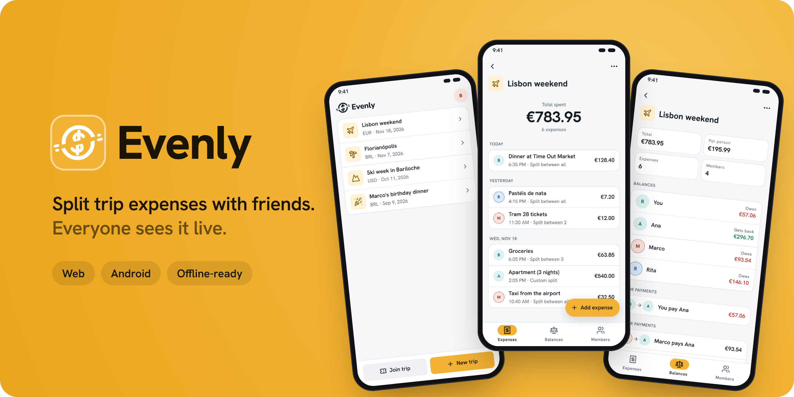
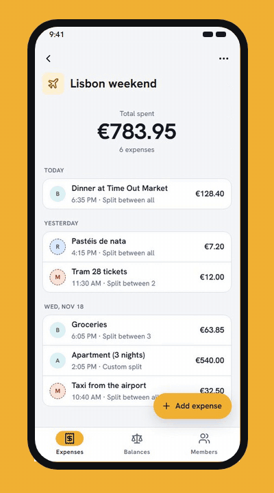
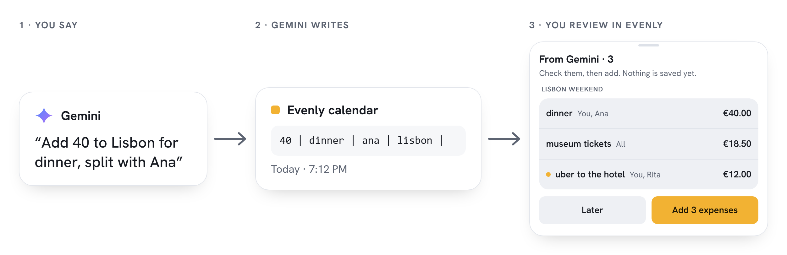
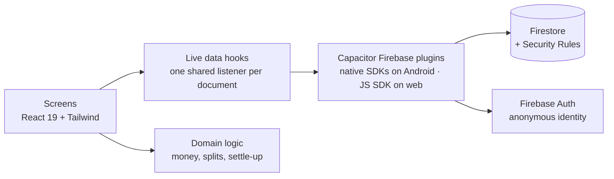

<p align="center">
  
</p>

<p align="center">
  <b>A fast, real-time alternative to Splitwise for trips.</b><br>
  Everyone adds what they paid; Evenly works out who owes whom, live on every phone.
</p>

<p align="center">
  <a href="https://github.com/brunokinast/evenly/actions/workflows/ci.yml"></a>
  <a href="https://github.com/brunokinast/evenly/releases/latest"></a>
  
  
</p>

<p align="center">
  <a href="https://evenly-app-6f5f2.web.app"><b>Open the web app</b></a> &nbsp;·&nbsp;
  <a href="https://github.com/brunokinast/evenly/releases/latest/download/evenly.apk"><b>Download for Android</b></a> &nbsp;·&nbsp;
  <a href="#how-its-built"><b>How it's built</b></a>
</p>

<br>

## Features

<table>
  <tr>
    <td width="50%" valign="top">
      <b>Live for everyone</b><br>
      A new expense shows up on every phone in about a second. No refresh button, and the app opens instantly from its offline copy.
    </td>
    <td width="50%" valign="top">
      <b>Fair settle-up</b><br>
      Balances and the fewest payments to even out, per person. Splits are equal or custom, and no cent is ever lost to rounding.
    </td>
  </tr>
  <tr>
    <td valign="top">
      <b>Join with a 6-digit code</b><br>
      No accounts or passwords. Friends without the app can be added as guests and claim their spot later.
    </td>
    <td valign="top">
      <b>Just tell Gemini</b><br>
      “Add 40 to Lisbon for dinner, split with Ana.” Evenly picks it up and asks you to confirm.
    </td>
  </tr>
</table>

<br>

<p align="center">
  <br>
  <sub>Adding an expense: saved instantly, balances update on everyone's phone.</sub>
</p>

<br>

## Just tell Gemini

<picture>
  <source media="(prefers-color-scheme: dark)" srcset="docs/readme/gemini-flow-dark.png">
  
</picture>

Gemini only calls apps Google has allow-listed, so Evenly meets it halfway: Gemini writes each expense as an event in a calendar named “Evenly”, and the Android app reads it from the phone's calendar. Nothing is saved until you check it; names and trips are matched forgivingly, and guesses are highlighted. [Why this design](docs/decisions/0008-gemini-calendar-bridge.md)

<br>

## How it's built

One React app runs as a website, as an installable PWA (iPhone) and inside Capacitor (Android). There is no server of its own: the app talks straight to Firebase, and Firestore Security Rules are the backend.



**A few decisions worth a look**

- **Security Rules as the whole backend.** Every write is one document or one batch, and the rules validate it: only members read or write a trip, payers and shares must be members, every field is type- and range-checked, and join attempts are rate-limited. No Cloud Functions, so it runs on Firebase's free plan. ([data model](docs/data-model.md))
- **One live-data layer.** Every piece of data on screen comes from a shared, reference-counted Firestore listener, so other people's changes simply appear. No manual caches. ([architecture](docs/architecture.md))
- **Saves don't wait for the server.** Firestore applies a write locally at once and syncs in the background, so saving closes immediately; a refused write comes back as a notice.
- **Speed is measured, not guessed.** A Playwright harness runs each journey on a throttled phone profile, and the startup bundle has a size budget that CI enforces. ([performance](docs/performance.md))

**Speed** (median on the live site, slow 4G, CPU 4× slower)

| Journey                                 | Target | Measured |
| --------------------------------------- | -----: | -------: |
| First open → name screen                |  2.5 s |    1.7 s |
| Returning launch → trips on screen      |  1.0 s |   0.35 s |
| Home → trip                             | 300 ms |    72 ms |
| Save → back on the trip, expense listed | 100 ms |    64 ms |

**Quality.** 70 unit tests, 46 Security Rules tests against the Firestore emulator and 41 phone-viewport end-to-end tests, all run by CI on every push. Behavior lives in [specs](specs/features) with acceptance-criteria IDs that the tests are named after, and decisions are recorded as [ADRs](docs/decisions). Built and maintained with Claude Code, following that spec-first process.

**Stack.** React 19 · TypeScript · Vite · Tailwind CSS 4 · Firebase (Auth, Firestore, Hosting) · Capacitor 8 · Vitest · Playwright

<br>

## Run it locally

Needs Node 24 and Java (for the Firebase emulators). Everything runs against local emulators; nothing touches real data.

```sh
npm install
npm run emulators   # Firestore + Auth emulators
npm run dev         # http://localhost:5173
```

`npm run check` runs typecheck, lint, unit and rules tests; `npm run e2e` runs the phone-viewport tests. More in [docs/architecture.md](docs/architecture.md).

<br>

<p align="center"><sub>Made by <a href="https://github.com/brunokinast">Bruno Kinast</a></sub></p>
